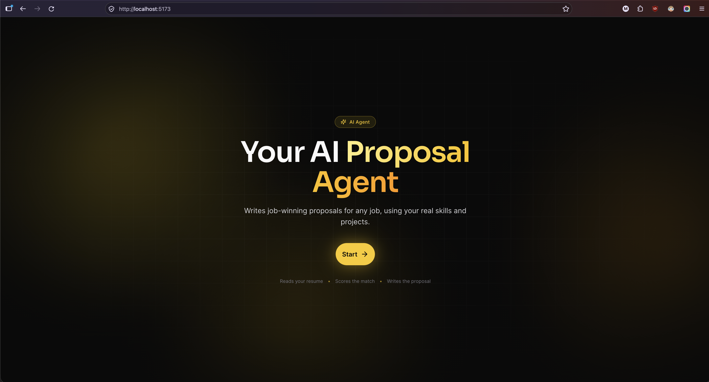
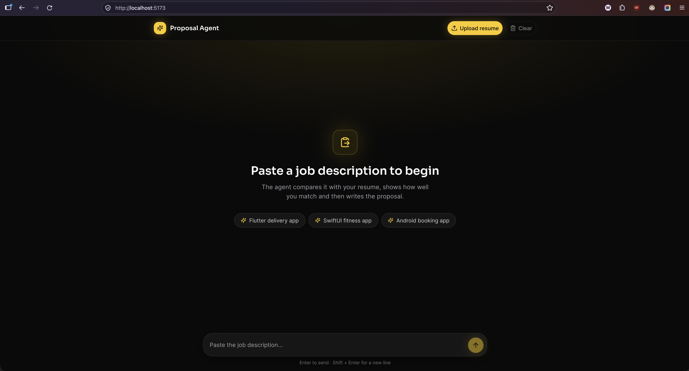
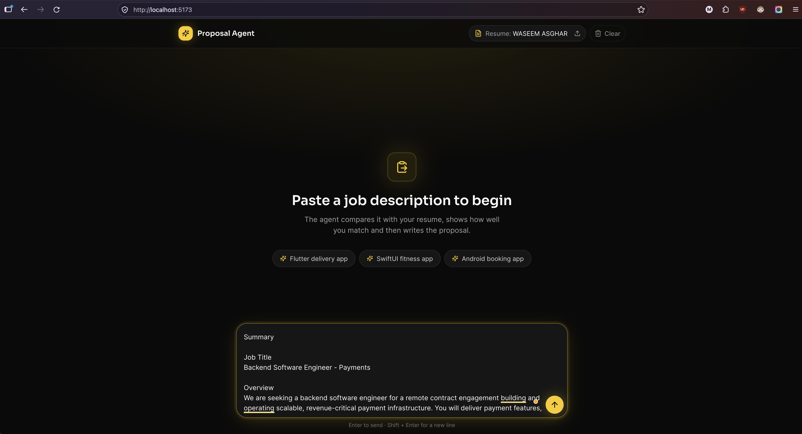
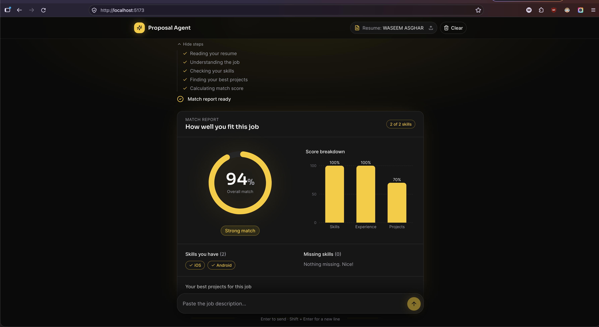
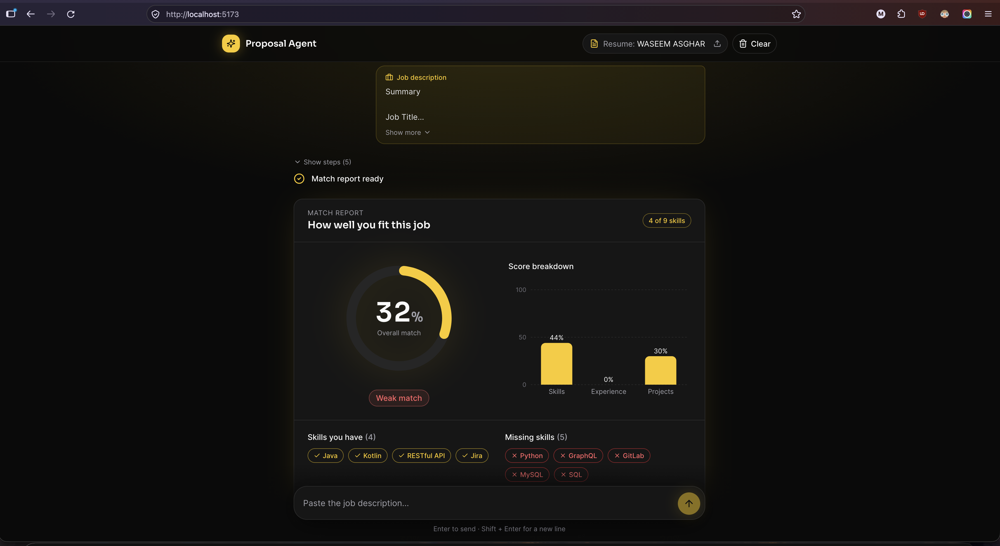
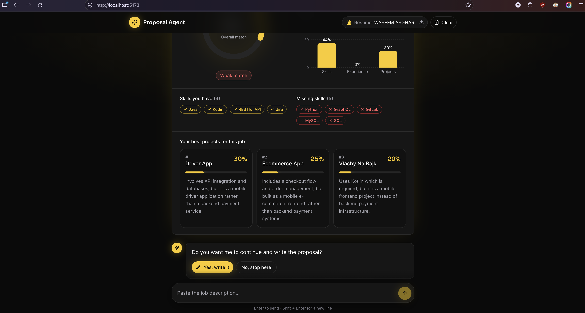
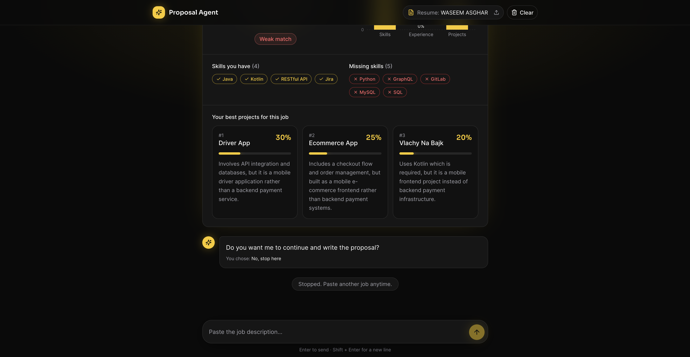
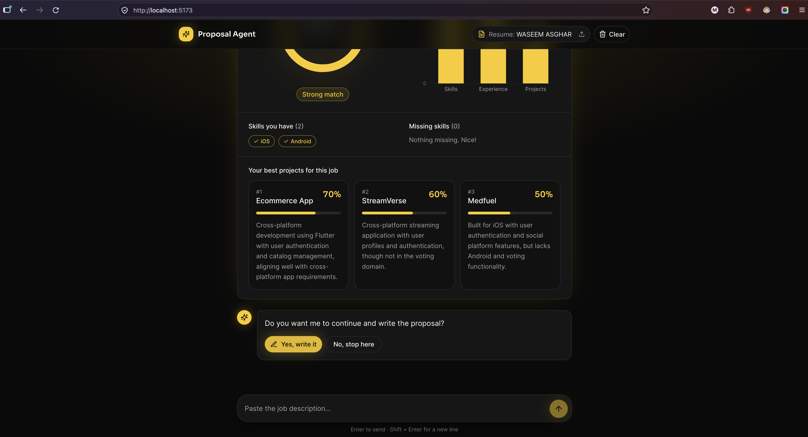
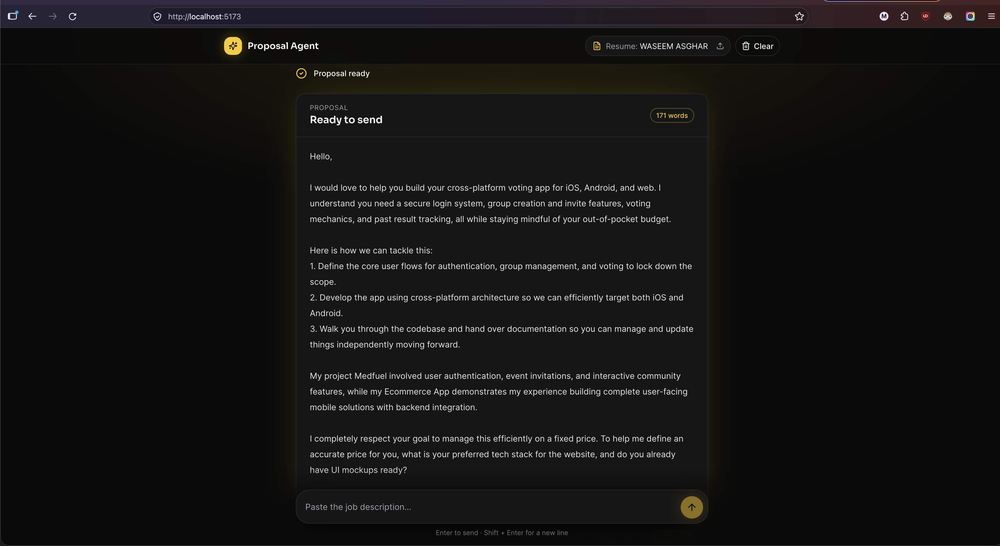
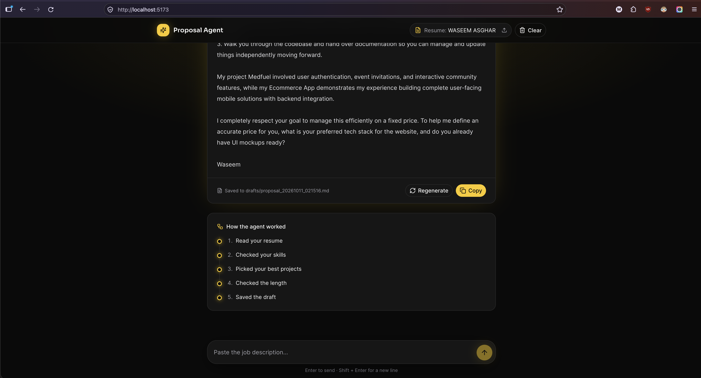

# Proposal Agent

An AI agent that reads your resume, compares it with a job description, shows how well you match, and then writes a proposal for that job using only your real skills and projects.



- **Backend:** Python, FastAPI, Google Gemini (`app/`)
- **Frontend:** React, TypeScript, Vite, Tailwind CSS, shadcn/ui, Recharts, Framer Motion (`agent_front_end/`)

---

## Table of contents

- [Screenshots](#screenshots)
- [Features](#features)
- [How it works](#how-it-works)
- [The 3 parts of every AI agent](#the-3-parts-of-every-ai-agent)
- [How the match score is calculated](#how-the-match-score-is-calculated)
- [Project structure](#project-structure)
- [Getting started](#getting-started)
- [Configuration](#configuration)
- [API reference](#api-reference)
- [Tests](#tests)
- [Privacy](#privacy)

---

## Screenshots

### 1. Workspace and job description

| Empty workspace | Pasting a job description |
|---|---|
|  |  |
| Upload your resume (PDF) and paste a job, or pick an example. | Multi-line input. Enter sends, Shift + Enter adds a new line. |

### 2. Match report

| Strong match | Weak match |
|---|---|
|  |  |
| The agent's steps, the overall score, and the skills, experience and projects breakdown. | An honest score: matched skills in yellow, missing skills in red. |

### 3. The agent asks before it continues

| Best projects + question | Choosing "No" |
|---|---|
|  |  |
| Top 3 projects with a relevance score and a reason. The agent waits for your answer. | Nothing is written. You can paste another job anytime. |

| Choosing "Yes" |
|---|
|  |

### 4. The proposal

| Written proposal | Copy, regenerate and agent steps |
|---|---|
|  |  |
| Written for this job only, with a word count. | Copy to clipboard, write a new version, and see which tools the agent used. |

---

## Features

- **Resume from PDF:** upload a PDF and Gemini turns it into structured data (skills, projects, work history).
- **Job matching:** an overall score plus a skills / experience / projects breakdown with charts.
- **Honest results:** missing skills are shown in red, and unrelated projects get a low score.
- **Smart skill matching:** "Firestore" or "FCM" on your resume counts as "Firebase", and tech used in your projects counts as your skills.
- **Inferred skills:** if a job lists no skills, the agent works out the few skills the job clearly needs.
- **Input checks:** text that is not a job description, or is shorter than 200 characters, is rejected before any AI call.
- **AI agent for the proposal:** the agent decides which tools to call, checks the length and saves a draft.
- **Human in the loop:** the agent shows the match report first and asks before writing.
- **Copy and regenerate:** one click to copy, one click for a new version.
- **Responsive UI:** works on mobile and desktop.

---

## How it works

```
 Resume PDF ──► POST /resume ──► Gemini reads it ──► data/resume.json
                                                         │
 Job description ──► POST /match ──► Gemini: job requirements
                                     Gemini: project relevance + related years
                                     Python: scores ──► Match report
                                                         │
                         "Do you want me to write the proposal?"
                                                         │ Yes
 POST /proposal ──► AI agent loop (tools) ──► Proposal + saved draft (drafts/*.md)
```

1. **Upload your resume.** The PDF text is read with PyMuPDF and Gemini returns a `Resume` object (structured output).
2. **Paste a job description.** Gemini pulls out the required skills, nice-to-have skills and minimum years.
3. **Match report.** Gemini rates your projects for this job and estimates your related years of experience. Plain Python then calculates the scores. Same input, same score.
4. **Proposal.** If you say yes, the AI agent writes the proposal using its tools.

> **Workflow vs agent:** `/match` is a fixed workflow: the code decides every step. `/proposal` is a real agent: the model decides which tool to call next.

---

## The 3 parts of every AI agent

Every AI agent, in any language or framework, is built from the same 3 parts. In this project they live in `app/proposal/`:

| Part | File | What it is |
|---|---|---|
| **1. Tools** | [`agent_tools.py`](app/proposal/agent_tools.py) | What the agent **can do**. One Python function per action. |
| **2. Prompt** | [`agent_prompt.py`](app/proposal/agent_prompt.py) | **Who** the agent is, **how** it should work, and the **rules** it must follow. |
| **3. Loop** | [`proposal_agent.py`](app/proposal/proposal_agent.py) | Ask the model → run the tool it asked for → send the result back. Repeat until it gives a final answer. |

### 1. Tools: what the agent can do

Each tool is a plain Python function. The function name, type hints and docstring are sent to Gemini, so the model knows when and how to call it.

| Tool | What it does |
|---|---|
| `get_resume()` | Returns the freelancer's resume: skills, projects, work history. |
| `check_skills(required_skills)` | Compares the job's skills with the resume. Returns score, matched and missing skills. |
| `find_projects(job_title, job_summary, required_skills)` | Returns the most relevant projects with a relevance score and reason. |
| `count_words(text)` | Counts the words in a draft (target: 120 to 220). |
| `save_draft(text)` | Saves the final proposal to `drafts/`. |

```python
def count_words(text: str) -> dict:
    """Count the words in a proposal draft. A good proposal is 120 to 220 words."""
    return {"word_count": len(text.split())}
```

### 2. Prompt: the agent's role, method and rules

The system prompt gives the agent its **role** (an expert proposal writer), its **method** (read the resume, check skills, find projects, write, count words, save) and its **rules**: never invent experience, mention real projects by name, no buzzwords, end with a question about the client's project.

### 3. Loop: the engine

The model never runs code itself. It only **asks** for a tool, and our loop runs it:

```python
for _ in range(settings.max_agent_steps):           # safety limit
    response = client.models.generate_content(model=..., contents=contents, config=config)

    if not response.function_calls:                  # no tool requested -> final answer
        return Proposal(text=response.text, ...)

    contents.append(response.candidates[0].content)  # keep the model's request in the history
    for call in response.function_calls:
        result = run_tool(call.name, call.args)      # WE run the tool
        results.append(Part.from_function_response(name=call.name, response=result))
    contents.append(Content(role="user", parts=results))  # send the results back
```

Key ideas:
- **The model is stateless.** The full history (job, tool requests, tool results) is sent on every call.
- **Step limit.** `max_agent_steps` stops an agent that never finishes.
- **Errors are results.** If a tool fails, the error is sent back as a result, so the agent can recover.
- **Transparency.** Every tool call is recorded in `steps` and shown in the UI under "How the agent worked".

---

## How the match score is calculated

```
overall = skills × 60% + experience × 20% + projects × 20%
```

| Score | How it is calculated |
|---|---|
| **Skills** | Matched job skills ÷ all job skills. One skill asked and you have it → 100%. Nothing to compare → 0%. |
| **Experience** | Your **related** years ÷ the years the job asks for. If the job asks for none, 3 related years = 100%. |
| **Projects** | Relevance of your best project for this job (0 to 100, rated by Gemini). Unrelated projects get 0 to 10. |

**Verdict:** 75%+ is a strong match, 50 to 74% a partial match, below 50% a weak match.

**Skill matching rules** (`app/match/match_scoring.py`):
- Names are normalized: `"RESTful APIs"` = `"REST API"`, `"Google Maps SDK"` = `"Google Maps"`.
- Skill families: `Firestore`, `FCM`, `Crashlytics`, `Remote Config` and any `Firebase ...` skill count as **Firebase**. `FCM`, `APNs` and `OneSignal` count as **Push notifications**.
- Your skills list **plus** the tech stack of every project is used.

**Guards:**
- Job descriptions shorter than 200 characters are rejected.
- Text that is not a job description (chat, greetings, random text) returns an error instead of a score.

---

## Project structure

```
proposal-agent-api/
├── app/                         # FastAPI backend
│   ├── main.py                  # creates the app, CORS, routers
│   ├── settings.py              # config from .env
│   ├── gemini_client.py         # one shared Gemini client
│   ├── resume/                  # upload and read the resume
│   │   ├── resume_routes.py     #   GET /resume, POST /resume
│   │   ├── pdf_text.py          #   read_pdf_text()
│   │   ├── resume_parser.py     #   parse_resume() with Gemini
│   │   ├── resume_storage.py    #   save_resume(), load_resume()
│   │   ├── resume_prompt.py
│   │   └── resume_models.py
│   ├── job/                     # understand the job description
│   │   ├── job_parser.py        #   parse_job() with Gemini
│   │   ├── job_length.py        #   minimum length check
│   │   ├── job_prompt.py
│   │   └── job_models.py
│   ├── match/                   # the match report
│   │   ├── match_routes.py      #   POST /match
│   │   ├── match_scoring.py     #   scores in plain Python
│   │   ├── project_ranking.py   #   project relevance + related years
│   │   └── match_models.py
│   └── proposal/                # the AI agent
│       ├── proposal_routes.py   #   POST /proposal
│       ├── agent_tools.py       #   1. Tools
│       ├── agent_prompt.py      #   2. Prompt
│       ├── proposal_agent.py    #   3. Loop
│       └── proposal_models.py
├── agent_front_end/             # React frontend
│   └── src/
│       ├── api/                 # apiClient, resumeApi, matchApi, proposalApi
│       ├── hooks/               # useAgentWorkspace (all state), useTimedSteps
│       ├── screens/             # WelcomeScreen, WorkspaceScreen
│       ├── components/          # welcome/, workspace/, agent/, match/, proposal/, ui/
│       ├── data/                # agent steps, tool labels, example jobs, limits
│       └── types/               # Resume, MatchReport, Proposal
├── tests/
│   └── test_match_scoring.py
├── data/                        # resume.json (not committed)
├── drafts/                      # saved proposals (not committed)
├── screenshots/
├── requirements.txt
└── .env.example
```

---

## Getting started

### Requirements

- Python 3.11+
- Node.js 18+
- A Google Gemini API key ([Google AI Studio](https://aistudio.google.com/apikey))

### 1. Backend

```bash
cd proposal-agent-api
python -m venv venv
source venv/bin/activate            # Windows: venv\Scripts\activate
pip install -r requirements.txt
cp .env.example .env                # then add your GEMINI_API_KEY
uvicorn app.main:app --port 4000 --reload
```

The API runs at http://127.0.0.1:4000 and the interactive docs at http://127.0.0.1:4000/docs.

### 2. Frontend

```bash
cd agent_front_end
npm install
npm run dev
```

Open http://localhost:5173, click **Start**, upload your resume and paste a job.

---

## Configuration

Backend (`.env` in `proposal-agent-api/`):

| Variable | Default | Description |
|---|---|---|
| `GEMINI_API_KEY` | (required) | Your Gemini API key |
| `MODEL_NAME` | `gemini-3.5-flash-lite` | Gemini model used for all calls |
| `MAX_UPLOAD_MB` | `5` | Maximum resume PDF size |
| `MAX_AGENT_STEPS` | `8` | Maximum loop steps for the proposal agent |
| `MIN_JOB_CHARS` | `200` | Minimum job description length |

Frontend (`.env` in `agent_front_end/`):

| Variable | Default | Description |
|---|---|---|
| `VITE_API_BASE_URL` | `http://127.0.0.1:4000` | Backend address |

---

## API reference

| Method | Endpoint | Body | Returns |
|---|---|---|---|
| `GET` | `/health` | | `{ "status": "ok" }` |
| `GET` | `/resume` | | `Resume` (404 if none uploaded) |
| `POST` | `/resume` | `multipart/form-data`, field `file` (PDF) | `Resume` |
| `POST` | `/match` | `{ "job_description": "..." }` | `MatchReport` |
| `POST` | `/proposal` | `{ "job_description": "..." }` | `Proposal` (can take 20 to 60 seconds) |

**Errors** come as `{ "detail": "message" }`, for example:

| Status | Message |
|---|---|
| 400 | `Only PDF files are allowed.` |
| 400 | `PDF must be under 5 MB.` |
| 400 | `No text found in this PDF (it may be scanned).` |
| 400 | `Upload your resume first.` |
| 400 | `Job description is too short. Paste the full job post (at least 200 characters).` |
| 400 | `This doesn't look like a job description. Paste the full job post.` |

<details>
<summary>Example responses</summary>

`MatchReport`
```json
{
  "overall_match": 84,
  "skill_match": 80,
  "experience_match": 100,
  "project_match": 80,
  "matched_skills": ["Flutter", "Google Maps", "Firebase", "Push notifications"],
  "missing_skills": ["Stripe"],
  "inferred_skills": [],
  "relevant_years": 4,
  "relevant_projects": [
    { "name": "Driver App", "relevance": 80, "reason": "Live location tracking on Google Maps." }
  ]
}
```

`Proposal`
```json
{
  "text": "Hi, ...",
  "word_count": 171,
  "steps": ["get_resume", "check_skills", "find_projects", "count_words", "save_draft"],
  "draft_file": "drafts/proposal_20261011_021516.md"
}
```
</details>

---

## Tests

```bash
python -m tests.test_match_scoring
```

Covers skill matching (aliases, skill families, empty lists), experience scoring and the overall formula.

---

## Privacy

These files are in `.gitignore` and are never committed:

- `.env` (your API key)
- `data/*.json`, `data/*.pdf` (your resume)
- `drafts/*.md` (generated proposals)
- `venv/`, `node_modules/`
